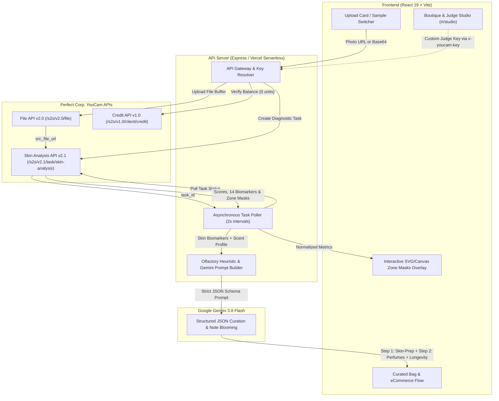

# DIAMANDIS · Skin-Informed Fragrance Selection

<p align="left">
  
  
  
  
  
</p>

> A luxury beauty-tech application built for the **YouCam API Skin AI & eCommerce VTO Hackathon**.  
> Diamandis diagnoses facial biomarkers with **Perfect Corp. YouCam Skin AI** to understand fragrance evaporation kinetics, calculate wear-time longevity, and curate a personalized pulse-point fragrance ritual.

---

## Demo Video

[](https://youtu.be/YdjZDcR0kks)

> *Demonstrating YouCam Skin AI diagnostic masks, custom judge API key verification, pulse-point priming, and Gemini-curated longevity.*

---

## Architecture & Data Flow



---

## YouCam APIs Integrated

Diamandis integrates three Perfect Corp. REST APIs:

1. **YouCam Skin Analysis API (`v2.1`)** (`/s2s/v2.1/task/skin-analysis`):
   - Asynchronous image processing detecting 7 core metrics across facial regions: `moisture`, `oiliness`, `texture`, `pore`, `radiance`, `redness`, and `skin_type` (`whole`, `t_zone`, `u_zone`).
   - Retrieves real diagnostic mask overlays (`mask_url`) projected directly onto the user's portrait.
2. **YouCam File API (`v2.0`)** (`/s2s/v2.0/file`):
   - Secure temporary upload storage for local user portraits (JPG/PNG).
3. **YouCam Credit API (`v1.0`)** (`/s2s/v1.0/client/credit`):
   - Consumes 0 units to verify API key validity and display remaining account units in the Judge Studio.

---

## How Skin Chemistry Shapes Scent (The Olfactory Science)

Fragrance molecules are lipophilic (oil-soluble). The skin's natural lipid film dictates evaporation kinetics, sillage, and longevity:

- **Raoult's Law & Vapor Pressure:** Epidermal lipid matrices lower the vapor pressure of non-polar fragrance compounds ($\log P > 2.5$), slowing diffusion and evaporative flash-off.
- **Sebaceous Fixation:** Human sebum contains ~12% squalene and ~26% wax esters, acting as natural chemical fixatives for volatile top notes (terpenes, aldehydes).
- **Pulse-Point Correlation:** The facial U-Zone (jawline and lower cheeks) directly borders neck and behind-the-ear pulse points, providing a precise non-invasive proxy for systemic lipid production.

---

## 2-Step Olfactory Ritual

1. **Step 1 · Skin-Prep Layering Base (`skinPrep`):** Determined **100% by YouCam skin metrics** (`oiliness`, `moisture`, `texture`, `pore`, `redness`). For high-sebum skin, it prescribes the *Oil-Balancing Niacinamide Gel Primer* to keep crisp notes true; for dry skin, it prescribes the *Ceramide & Squalane Lipid Balm* to lock in volatile accords.
2. **Step 2 · Curated Perfumes (`recommendations`):** Bridges the user's **Preferred Scent Profile** with their **Skin Retention Profile**. Recommends 3 fragrances (`EDT`, `EDP`, `Extrait`), calculates wear-time longevity in hours (e.g., `⏱ 7–9 hours`), and explains note blooming on this specific skin.
3. **Personal Bottle Check (Optional):** Evaluates how any fragrance the user already owns behaves on their skin metrics.

---

## For Judges: Testing with Your Own YouCam API Key

You can test Diamandis using either the pre-configured server demo key or your own key:

1. Click **🏛 Boutique** in the top navigation bar (or visit `#/studio`).
2. Paste your Perfect Corp. API key into the **YouCam API Key Override** input.
3. Click **Verify Key & Check Balance (0 Units)** to verify your account.
4. Return to **🛍 Shopper** mode — all subsequent analyses will use your custom key via the `x-youcam-key` header without storing it on the server.

---

## Local Setup & Development

### Prerequisites

- Node.js 18+
- Perfect Corp. YouCam API Key (`PERFECTCORP_API_KEY`)
- Google Gemini API Key (`GEMINI_API_KEY`)

### Installation

1. Clone repository and install dependencies:
   ```bash
   git clone https://github.com/vero-code/diamandis.git
   cd diamandis
   npm install
   ```

2. Create `server/.env` with your credentials:
   ```env
   PERFECTCORP_API_KEY=your_youcam_api_key
   GEMINI_API_KEY=your_gemini_api_key
   PORT=3001
   ```

3. Start the Express API server:
   ```bash
   npm run server
   ```

4. In a separate terminal, start the Vite client:
   ```bash
   npm run dev
   ```
   Open `http://localhost:5173` in your browser.

---

## License & Compliance

- Built for the **YouCam API Skin AI & eCommerce VTO Hackathon**.
- Adheres to the **Official Perfect Corp. API Guidelines**: masks retained up to 2 hours, temporary uploads up to 30 days.
- **Medical Disclaimer:** Metric scores and fragrance recommendations are provided for cosmetic, sensory, and shopping reference only; they do not constitute medical advice or clinical diagnosis.